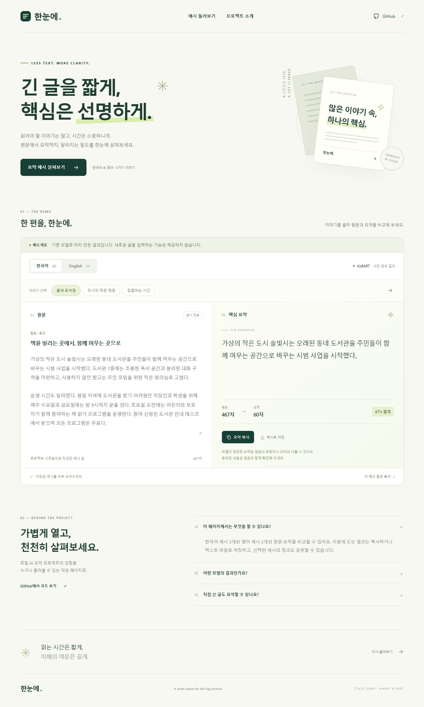
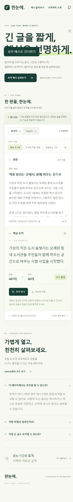

<p align="center">
  
</p>

<h1 align="center">한눈에.</h1>
<p align="center"><strong>긴 글을 짧게, 핵심은 선명하게.</strong><br>적게 읽고, 선명하게 이해하는 한국어·영어 요약 데모</p>
<p align="center">
  <a href="https://dlwo8520.github.io/hannune-summary-demo/"><strong>데모 둘러보기 ↗</strong></a>
  &nbsp;·&nbsp;
  <a href="#로컬에서-실행">로컬 실행</a>
  &nbsp;·&nbsp;
  <a href="#구조">파일 구조</a>
</p>
<p align="center">
  
  
  
</p>



<details>
  <summary>모바일 화면 보기</summary>
  <br>
  
</details>

## 프로젝트

**한눈에**는 로컬 AI 텍스트 요약 프로젝트의 화면과 결과를 누구나 살펴볼 수 있도록 만든 정적 데모입니다. 원문과 핵심 요약을 나란히 놓고, 글의 길이와 정보 밀도가 어떻게 달라지는지 비교합니다.

한국어 **KoBART**와 영어 **BART**의 기존 로컬 가중치·생성 설정을 유지한 채 다섯 가지 예시를 한 번 생성해 저장했습니다. 웹사이트는 저장된 글과 결과만 표시합니다.

> **실시간 요약 서비스가 아닙니다.** 새 글 입력, 서버 추론, 외부 AI API 호출은 제공하지 않습니다. 모든 예시 원문은 시연을 위해 직접 작성한 가상의 문서이며 실제 뉴스 보도가 아닙니다. 모델 출력은 추가로 교정하지 않고 그대로 담았습니다.

## 둘러볼 수 있는 것

| 기능 | 동작 |
| --- | --- |
| 한국어 · 영어 전환 | 한국어 3개와 영어 2개 예시를 즉시 표시 |
| 원문 · 요약 비교 | 읽기 전용 원문과 사전 생성한 요약을 나란히 확인 |
| 글자 수 비교 | 공백·줄바꿈을 포함한 문자 수와 감소 비율 계산 |
| 복사 · 저장 | 요약 복사, 원문·요약이 포함된 UTF-8 텍스트 다운로드 |
| 예시 공유 | `?example=library`처럼 선택한 예시로 바로 연결 |
| 반응형 화면 | 데스크톱에서는 2열, 모바일에서는 1열 구성 |
| 접근성 | 키보드 탐색, 초점 표시, 상태 알림, 움직임 줄이기 지원 |

### 다섯 가지 이야기

| 언어 | 예시 | 모델 |
| --- | --- | --- |
| 한국어 | 동네 도서관 · 도시의 작은 정원 · 집중하는 시간 | KoBART |
| English | The repair café · A walkable street | BART |

## 로컬에서 실행

사이트 자체에는 설치하거나 빌드할 의존성이 없습니다. `docs/index.html`을 직접 열어도 예시를 볼 수 있습니다. 클립보드 복사 기능은 HTTPS 또는 localhost에서 사용하는 것을 권장합니다. 브라우저가 복사를 제한하면 안내 메시지를 표시합니다.

Node.js 22 이상이 있다면:

```bash
npm start
```

`http://127.0.0.1:4173`에 접속합니다.

Python이 설치되어 있다면 다음 방법도 가능합니다.

```bash
python -m http.server 4173 --bind 127.0.0.1 --directory docs
```

### 검사

```bash
npm test
```

Node.js 기본 테스트 도구로 예시 데이터, 상대 경로, 정적 배포 범위, 외부 호출 및 민감 정보 패턴을 확인합니다. 추가 패키지는 설치하지 않습니다.

## GitHub Pages

공개 저장소의 **Settings → Pages**에서 아래와 같이 설정합니다.

| 항목 | 값 |
| --- | --- |
| Source | Deploy from a branch |
| Branch | `main` |
| Folder | `/docs` |

배포가 완료되면 `https://dlwo8520.github.io/hannune-summary-demo/`에서 볼 수 있습니다. 공개 저장소의 GitHub Pages는 무료로 사용할 수 있습니다. [공식 배포 안내](https://docs.github.com/en/pages/getting-started-with-github-pages/configuring-a-publishing-source-for-your-github-pages-site)

HTML·CSS·JavaScript만 제공하므로 방문 시 별도의 PC나 모델 서버를 켜둘 필요가 없습니다. 도메인을 따로 구매하지 않아도 됩니다.

## 구조

```text
.
├── docs/                    # GitHub Pages에 공개되는 폴더
│   ├── index.html
│   ├── .nojekyll
│   └── assets/
│       ├── styles.css       # 반응형 스타일
│       ├── app.js           # 예시 선택, 복사, 다운로드, 공유
│       ├── examples.js      # 고정 원문과 모델 생성 결과
│       └── mark.svg         # 로고
├── .github/assets/          # README 화면 미리보기
├── scripts/serve.mjs         # 의존성 없는 로컬 미리보기 서버
├── test/static.test.mjs      # 정적 공개 범위 및 데이터 검사
└── package.json
```

## 예시 수정

`docs/assets/examples.js`의 항목을 수정하면 됩니다. `id`, `language`(`kr` / `en`), `category`, `label`, `title`, `source`, `summary`, `model` 필드를 사용합니다. 언어별 예시 버튼과 글자 수는 데이터에 맞춰 자동으로 갱신됩니다.

원본 Django 서버, 모델 가중치, 토크나이저, 데이터베이스, 환경 변수, Cloudflare 인증 정보는 이 저장소에 포함하지 않습니다. 이 데모를 실행하는 데 API 키는 필요하지 않습니다.

---

<p align="center">A small space for the big picture.<br><strong>한눈에.</strong></p>
